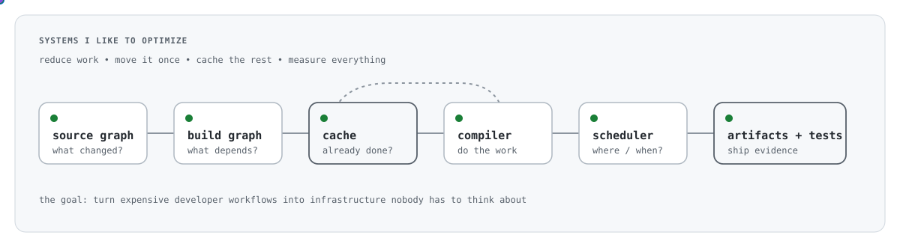
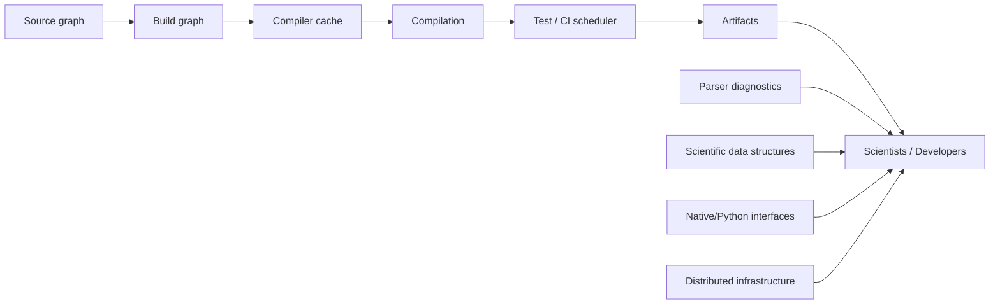
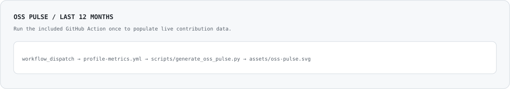

# Hussein Faara

<p align="center">
  
</p>

<p align="center">
  <a href="https://github.com/whosayn?tab=repositories"></a>
  <a href="https://github.com/rdkit/rdkit"></a>
  
  
  
</p>

<h3 align="center">I make expensive software workflows boring.</h3>

<p align="center">
  I work on infrastructure-heavy problems where <b>performance, portability, and developer experience</b> all matter:
  build graphs, caches, schedulers, parsers, native/Python boundaries, and scientific software.
</p>

---

## Visual map



<p align="center">
  <sub>My favorite engineering problems usually live somewhere in this graph.</sub>
</p>

---

## OSS pulse

<p align="center">
  
</p>

---

## What I like building

<table>
  <tr>
    <td valign="top" width="33%">
      <h3>⚙️ Build & CI</h3>
      <p>Dependency graphs, caching, distributed builds, reproducible environments, packaging, and CI systems that reduce wasted work.</p>
    </td>
    <td valign="top" width="33%">
      <h3>🚀 Performance</h3>
      <p>Latency reduction, memory efficiency, throughput tuning, data structures, parser performance, and removing hidden bottlenecks.</p>
    </td>
    <td valign="top" width="33%">
      <h3>🧪 Scientific software</h3>
      <p>Cheminformatics, molecular representations, native/Python interfaces, graph algorithms, and infrastructure for computation-heavy workflows.</p>
    </td>
  </tr>
</table>

---

## Selected engineering work

<table>
  <tr>
    <td valign="top" width="50%">
      <h3>🧪 RDKit</h3>
      <p>Contributor to the C++ core of <a href="https://github.com/rdkit/rdkit">RDKit</a>, a widely used cheminformatics toolkit.</p>
      <ul>
        <li><b>ccache integration work</b> to speed up iterative development and reduce rebuild cost</li>
        <li><b>#8675</b> fixed parse error handling for invalid characters</li>
        <li><b>#6906</b> addressed unnecessary vector copying in <code>PositionVariationOp::getVariationCounts()</code></li>
        <li><b>#8742</b> proposed efficient extraction of small subgraphs from very large molecules</li>
        <li><b>#8612</b> improved parser diagnostics by identifying the precise offending character/token</li>
      </ul>
      <p><b>Why it matters:</b> correctness, performance, build acceleration, and API design are much stronger signals than generic cleanup.</p>
    </td>
    <td valign="top" width="50%">
      <h3>🛡️ sourceguard</h3>
      <p><a href="https://github.com/whosayn/sourceguard">sourceguard</a> is a developer-tooling project for keeping prohibited source patterns out of new changes.</p>
      <p><b>Idea:</b> enforcement belongs as close as possible to the developer feedback loop.</p>
      <hr>
      <h3>🧬 rdkit_smiles</h3>
      <p><a href="https://github.com/whosayn/rdkit_smiles">rdkit_smiles</a> explores lexing, grammar, parsing, and molecular graph construction in C++.</p>
      <p><b>Why I like it:</b> it sits at the intersection of language tooling, graph structure, and scientific computing.</p>
    </td>
  </tr>
</table>

---

## Things I enjoy debugging

```text
slow build
   │
   ├─ duplicated work? ───────────────► cache it
   ├─ bad dependency graph? ──────────► fix the graph
   ├─ poor scheduling? ───────────────► move the bottleneck
   ├─ serialization / I/O? ───────────► measure bytes, not vibes
   ├─ cross-platform divergence? ─────► remove special cases
   └─ nobody knows why it's slow? ────► instrument first
```

---

## Current rabbit holes

<p>
  
  
  
  
  
  
  
  
</p>

---

## A few principles

<table>
  <tr>
    <td valign="top" width="25%"><b>Build platforms, not patches</b><br><sub>solve the recurring problem once</sub></td>
    <td valign="top" width="25%"><b>Measure first</b><br><sub>profile before optimizing</sub></td>
    <td valign="top" width="25%"><b>Reduce hidden work</b><br><sub>cache, simplify, and make bottlenecks visible</sub></td>
    <td valign="top" width="25%"><b>Make it boring</b><br><sub>good infrastructure fades into the background</sub></td>
  </tr>
</table>

---

<details>
  <summary><b>More GitHub archaeology</b></summary>
  <br>
  <ul>
    <li><a href="https://github.com/whosayn/check-old-commit-date">check-old-commit-date</a> — pre-commit tooling around stale commit timestamps</li>
    <li>experiments in developer tooling, parsing, and systems-oriented utilities</li>
    <li>ongoing interest in infrastructure that compounds engineer productivity</li>
  </ul>
</details>

---

<p align="center">
  <sub>
    Preferred metric: <code>before → after</code>, not “feels faster”.
    &nbsp;•&nbsp;
    <a href="https://husseinfaara.com">website</a>
  </sub>
</p>
