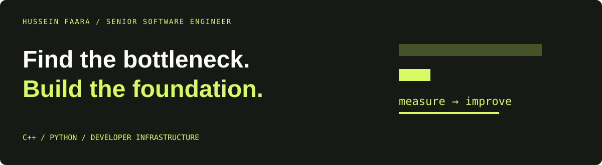

# Hussein Faara
**Senior Software Engineer | Systems · Infrastructure · Performance**

My favorite bugs hide between components: the cache that misses, the dependency edge that rebuilds everything, the parser that loses context, the network call inside a logging path.

I build and optimize the platforms underneath those workflows.

[Engineering portfolio](https://husseinfaara.com) · [Email](mailto:faarahussein@gmail.com) · [Repositories](https://github.com/whosayn?tab=repositories)

## `$ cat impact.txt`

```text
clean build time       −78%
engineers enabled      300+
shared data foundation 10 databases → 1
logging latency        −20%
```

[Read the project context →](https://husseinfaara.com)

## `$ inspect competencies`

| Layer | Engineering depth |
| --- | --- |
| **Build** | Dependency graphs, compiler caches, reproducible environments, CI/CD, cross-platform packaging |
| **Execute** | C++, Python, native interfaces, HPC, schedulers, distributed execution |
| **Store** | Storage abstractions, multiple database engines, serialization, compression |
| **Understand** | Profiling, latency, throughput, memory, parser diagnostics, graph algorithms |
| **Enable** | Architecture ownership, engineering standards, developer feedback loops |

## `$ git log --selected`

**RDKit / scientific C++**

| Engineering problem | Selected work |
| --- | --- |
| Build feedback loops | RDKit ccache integration work to improve iterative development and reduce rebuild cost |
| Parser correctness | [Invalid-character parse errors · RDKit #8675](https://github.com/rdkit/rdkit/issues/8675) |
| Performance in C++ | [Unnecessary vector copying · RDKit #6906](https://github.com/rdkit/rdkit/issues/6906) |
| Precise diagnostics | [Offending character/token identification · RDKit #8612](https://github.com/rdkit/rdkit/issues/8612) |
| Graph APIs | [Small-subgraph extraction proposal · RDKit #8742](https://github.com/rdkit/rdkit/issues/8742) |

**Personal tooling**

- **[sourceguard](https://github.com/whosayn/sourceguard)** — developer tooling to keep prohibited source patterns out of new changes.
- **[rdkit_smiles](https://github.com/whosayn/rdkit_smiles)** — C++ exploration of lexing, grammar, parsing, and molecular graph construction.
- **[check-old-commit-date](https://github.com/whosayn/check-old-commit-date)** — pre-commit tooling around stale commit timestamps.

## `$ trace slow-build`

```text
slow build
  ├─ repeated compilation?       → inspect cache reuse
  ├─ too many invalidations?     → inspect dependency edges
  ├─ idle workers?               → inspect scheduling
  ├─ time spent moving bytes?    → inspect I/O and serialization
  └─ unknown cost?               → instrument first
```

## `$ connect`

Hiring for developer infrastructure, C++ systems, platform architecture, or performance engineering? [Let’s talk](mailto:faarahussein@gmail.com).
