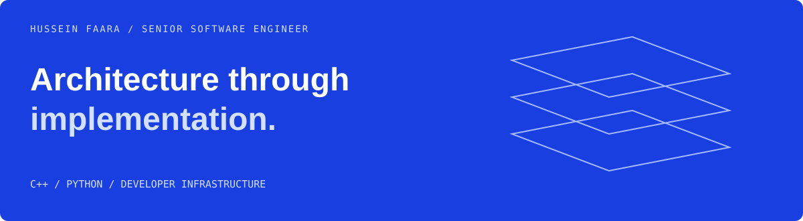

# Hussein Faara
**Senior Software Engineer — systems, infrastructure, and scientific software**

I work where architecture meets implementation: dependency graphs, native/Python boundaries, storage abstractions, schedulers, parsers, and the hidden costs in a critical path.

[Engineering portfolio](https://husseinfaara.com) · [Email](mailto:faarahussein@gmail.com) · [Repositories](https://github.com/whosayn?tab=repositories)

## 01 / Competencies in context

### Developer infrastructure
Reproducible dependency resolution, build caching, packaging, and distribution across Linux, macOS, Windows, x86_64, and ARM. Tools include **Pixi, rattler-build, ccache, and CI/CD**.

**Engineering focus:** reduce duplicated work and improve the developer feedback loop.

### Systems architecture & storage
Shared abstractions and APIs supporting multiple storage engines and applications. Consolidated **ten internal databases into one foundation**.

**Engineering focus:** make the boundary between applications and storage easier to work with.

### Performance & systems programming
High-performance C++, profiling across C++ and Python, data structures, compression, and parser diagnostics. Optimized a shared logging path with a **20% latency improvement**.

**Engineering focus:** understand the cost before changing the implementation.

### Scientific & distributed computing
Cheminformatics, molecular representations, graph algorithms, native/Python interfaces, HPC, scheduling, and distributed execution.

**Engineering focus:** make computation-heavy workflows practical to build and run.

### Technical leadership
Architecture ownership, engineering standards, cross-team influence, and infrastructure that enables other developers. **300+ engineers enabled** across my work.

[Selected engineering outcomes and context →](https://husseinfaara.com)

## 02 / Inspect the work

### RDKit / C++ core contributions

| Engineering problem | Selected work |
| --- | --- |
| Build feedback loops | RDKit ccache integration work to improve iterative development and reduce rebuild cost |
| Parser correctness | [Invalid-character parse errors · RDKit #8675](https://github.com/rdkit/rdkit/issues/8675) |
| Performance in C++ | [Unnecessary vector copying · RDKit #6906](https://github.com/rdkit/rdkit/issues/6906) |
| Precise diagnostics | [Offending character/token identification · RDKit #8612](https://github.com/rdkit/rdkit/issues/8612) |
| Graph APIs | [Small-subgraph extraction proposal · RDKit #8742](https://github.com/rdkit/rdkit/issues/8742) |

### Developer tooling / personal projects

- **[sourceguard](https://github.com/whosayn/sourceguard)** — developer tooling to keep prohibited source patterns out of new changes.
- **[rdkit_smiles](https://github.com/whosayn/rdkit_smiles)** — C++ exploration of lexing, grammar, parsing, and molecular graph construction.
- **[check-old-commit-date](https://github.com/whosayn/check-old-commit-date)** — pre-commit tooling around stale commit timestamps.

## 03 / How I approach a system

```text
map the dependencies
        ↓
measure the critical path
        ↓
remove unnecessary work
        ↓
validate correctness + performance
        ↓
make the improvement repeatable
```

<details>
<summary><strong>Technical interests & tools</strong></summary>

**Core:** C++, Python, Linux, build systems, CI/CD, SQL, Docker, scientific computing.

**Exploring:** remote build caching, distributed CI, Rust build tooling, Go backends, and storage systems.

</details>

## Next / Infrastructure that other teams build on

I’m interested in senior systems, developer infrastructure, platform, and performance engineering opportunities.

[Engineering portfolio](https://husseinfaara.com) · [Email](mailto:faarahussein@gmail.com) · [Repositories](https://github.com/whosayn?tab=repositories)
