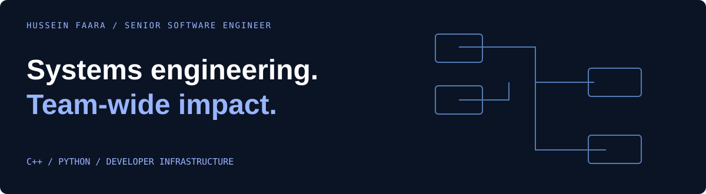

# Hussein Faara
**Senior Software Engineer · C++ / Python · Developer Infrastructure**

I build the infrastructure other engineers depend on: reproducible builds, shared platforms, and performance-critical systems. My work spans native software, scientific computing, and developer productivity.

[Engineering portfolio](https://husseinfaara.com) · [Email](mailto:faarahussein@gmail.com) · [Repositories](https://github.com/whosayn?tab=repositories)

## Selected engineering impact

| Build time | Developer reach | Platform architecture | Logging latency |
| --- | --- | --- | --- |
| **78% reduction** in clean build time | **300+ engineers** enabled | **10 databases → 1** shared foundation | **20% improvement** in a critical path |

[Context and selected engineering work →](https://husseinfaara.com)

## Core competencies

| Competency | What I work on |
| --- | --- |
| **Developer infrastructure** | Build graphs, caching, CI/CD, reproducible environments, cross-platform packaging |
| **Systems architecture** | Shared APIs, storage abstractions, multi-engine data platforms |
| **Performance engineering** | C++ and Python profiling, latency, memory, throughput, unnecessary work |
| **Scientific & compute infrastructure** | Molecular graphs, parsers, native/Python interfaces, HPC and distributed execution |
| **Technical leadership** | Architecture ownership, engineering standards, cross-team developer enablement |

## Open-source evidence

Contributor to the C++ core of [RDKit](https://github.com/rdkit/rdkit). Selected work and proposals:

| Engineering problem | Selected work |
| --- | --- |
| Build feedback loops | RDKit ccache integration work to improve iterative development and reduce rebuild cost |
| Parser correctness | [Invalid-character parse errors · RDKit #8675](https://github.com/rdkit/rdkit/issues/8675) |
| Performance in C++ | [Unnecessary vector copying · RDKit #6906](https://github.com/rdkit/rdkit/issues/6906) |
| Precise diagnostics | [Offending character/token identification · RDKit #8612](https://github.com/rdkit/rdkit/issues/8612) |
| Graph APIs | [Small-subgraph extraction proposal · RDKit #8742](https://github.com/rdkit/rdkit/issues/8742) |

## Developer tools & experiments

- **[sourceguard](https://github.com/whosayn/sourceguard)** — developer tooling to keep prohibited source patterns out of new changes.
- **[rdkit_smiles](https://github.com/whosayn/rdkit_smiles)** — C++ exploration of lexing, grammar, parsing, and molecular graph construction.
- **[check-old-commit-date](https://github.com/whosayn/check-old-commit-date)** — pre-commit tooling around stale commit timestamps.

## Let’s connect

Interested in senior engineering roles in **developer infrastructure, systems, platform architecture, and performance**.

[Discuss an engineering opportunity →](mailto:faarahussein@gmail.com)
